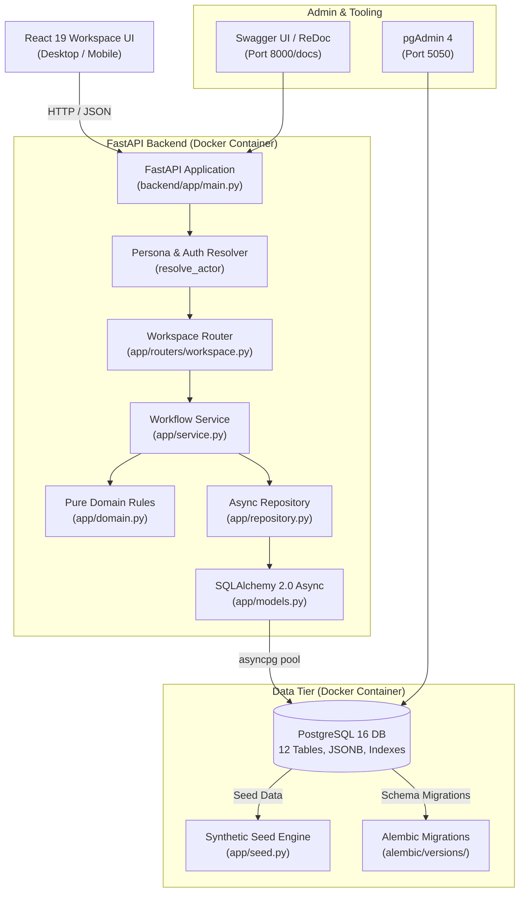
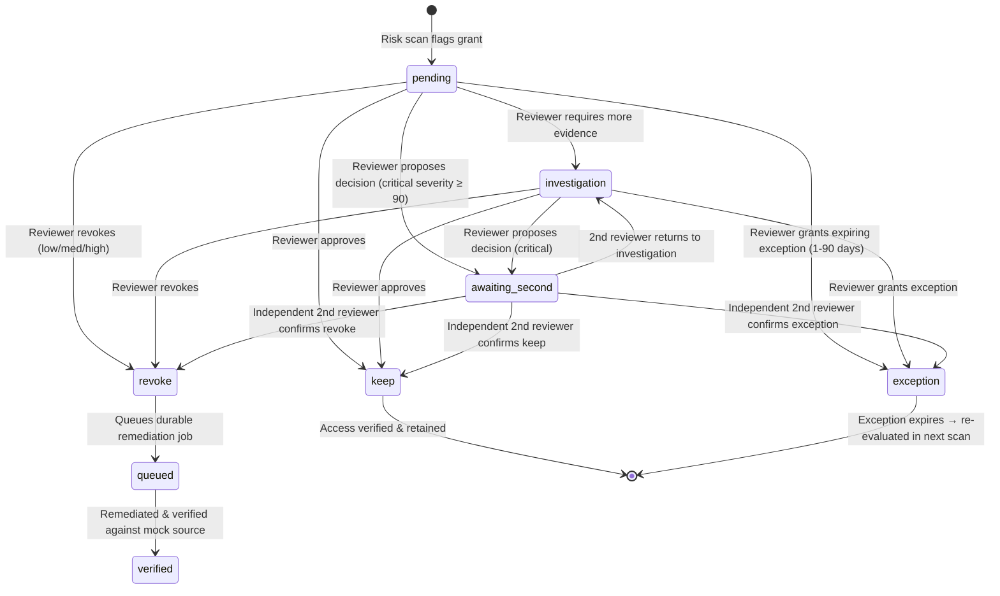
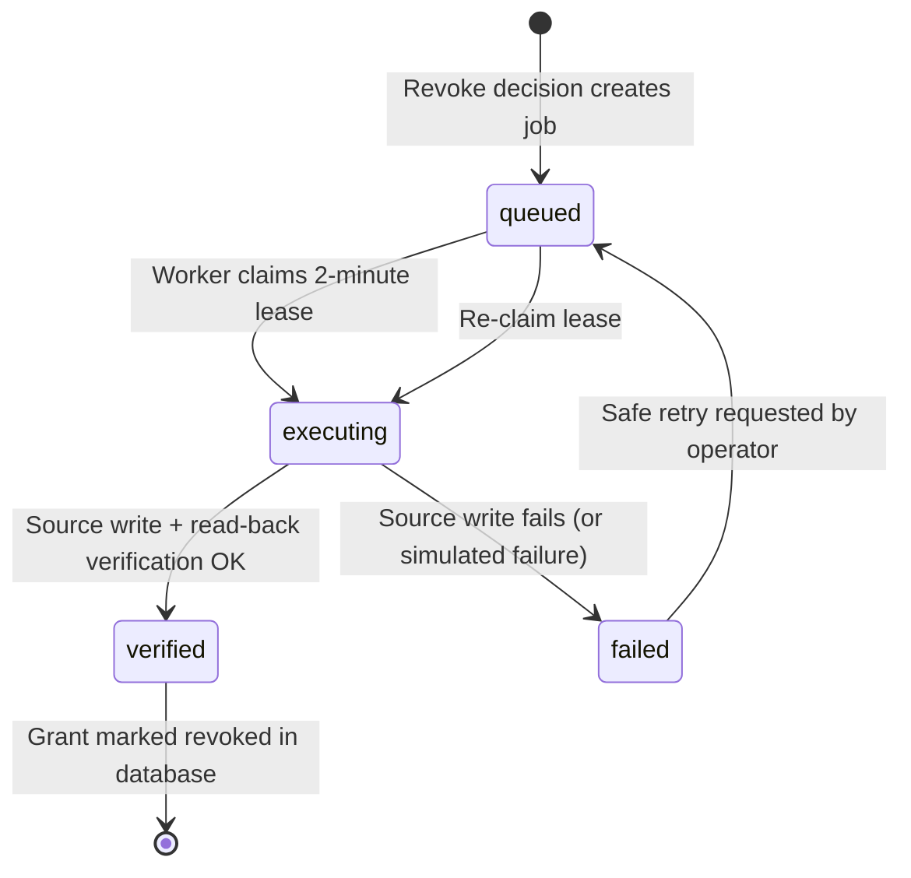

# Architecture

## Design Principles

- **Modular Monolith & Microservice-Ready** — Clean boundaries separating pure domain rules, use case services, and data persistence.
- **Enterprise-Grade Storage** — **PostgreSQL 16** with native UUIDv4, JSONB evidence snapshots, arrays, and partial unique indexes.
- **Async High-Throughput API** — **FastAPI** with `asyncpg` and `SQLAlchemy 2.0 (async)` for non-blocking I/O.
- **Containerized Deployment** — Production-ready multi-stage **Dockerfile** and **Docker Compose** orchestration.
- **Tenant Isolation** — All tables scoped by `workspace_id` foreign keys with `ON DELETE CASCADE`.
- **Evidence Integrity & Optimistic Concurrency** — Version-stamped reviews, grants, and remediations prevent stale decisions or lost updates.

---

## Dual Runtime Architecture

AccessGuard provides two deployment runtimes:

1. **Enterprise Containerized Runtime (Primary)**:
   - **Frontend**: React 19 UI
   - **Backend**: Python FastAPI with async routes and OpenAPI / Swagger documentation
   - **Database**: PostgreSQL 16 with Alembic version-controlled migrations
   - **Infrastructure**: Docker & Docker Compose (`db`, `backend`, `pgadmin`)

2. **Serverless Edge Prototype**:
   - Next.js 16 via Vinext on Vite running in Cloudflare Workers with local D1 SQLite.

---

## FastAPI + PostgreSQL System Architecture

---

## Layer Responsibilities (Backend)

| Layer               | Location                     | Tech / Tools            | Responsibility                                                  |
| ------------------- | ---------------------------- | ----------------------- | --------------------------------------------------------------- |
| **API Boundary**    | `backend/app/routers/`       | FastAPI, Pydantic v2    | Route handling, request validation, HTTP exceptions, CSV export |
| **Pure Domain**     | `backend/app/domain.py`      | Pure Python (Zero I/O)  | 6 risk policies, score calculation, authorization checks        |
| **Service**         | `backend/app/service.py`     | Async Python            | Orchestrates scans, decisions, dual approvals, remediations     |
| **Data Repository** | `backend/app/repository.py`  | SQLAlchemy async select | Tenant-scoped data access, audit generation, workspace snapshot |
| **Data Models**     | `backend/app/models.py`      | SQLAlchemy Declarative  | Table definitions, relationships, indexes, constraints          |
| **Seed Engine**     | `backend/app/seed.py`        | Deterministic UUID      | Generates complete demo workspace on initialization             |
| **Migrations**      | `backend/alembic/`           | Alembic                 | Declarative, reversible schema upgrades and downgrades          |

---

## Decision State Machine

---

## Remediation Lifecycle

---

## Security Model

- **Workspace Isolation:** Workspace ID derived from verified principal or platform session, preventing cross-tenant access.
- **Role-Based Access Control:** 4 roles enforced at the service/endpoint layer (`admin`, `reviewer`, `security`, `auditor`).
- **Self-Approval Prevention:** Reviewers cannot review their own accounts or grants.
- **Mandatory Independent Second Approval:** Critical severity reviews (score ≥ 90) require two distinct approvers.
- **Lease-Based Worker Concurrency:** 2-minute lease timeouts prevent stuck jobs while guarding against double-execution.
- **Append-Only Auditing:** Every decision, scan, policy change, and export is recorded in `audits` table.
- **CSV Injection Defense:** Leading formula trigger characters (`=`, `+`, `-`, `@`, `\t`, `\r`) are escaped with a single quote prefix in all CSV exports.
