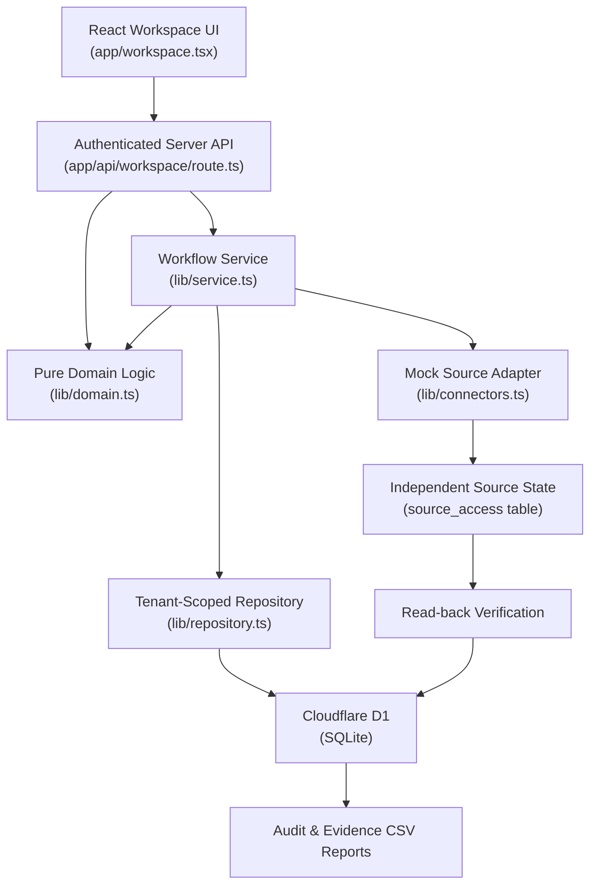
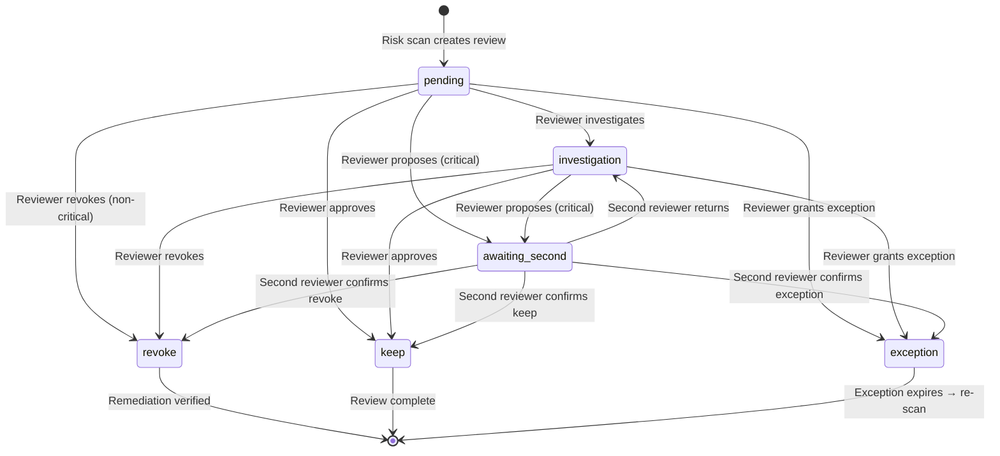
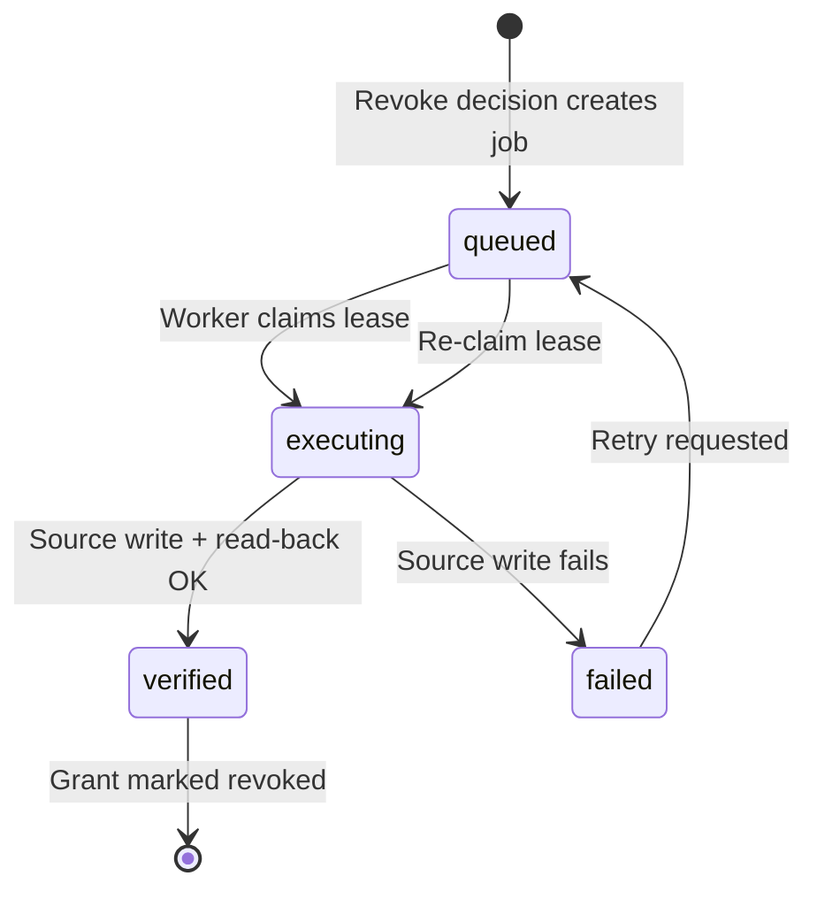

# Architecture

## Design Principles

- **Single deployable** — Modular monolith with separated concerns, not microservices
- **Clean layer separation** — `domain.ts` → `service.ts` → `repository.ts`
- **Tenant isolation** — All queries scoped by workspace ID derived from authenticated identity, never from client input
- **Transactional consistency** — D1 batch API for atomic multi-statement operations
- **Evidence integrity** — Evidence changes invalidate stale decisions and executions
- **Optimistic concurrency** — Version checks prevent lost updates on all mutable entities

## Layer Architecture

### Layer Responsibilities

| Layer               | File                  | Responsibility                                                  |
| ------------------- | --------------------- | --------------------------------------------------------------- |
| **UI**              | `app/workspace.tsx`   | Dashboard, review workflow, remediation, audit trail, imports   |
| **API Boundary**    | `app/api/.../route.ts`| Authentication, origin checks, request routing, response format |
| **Domain (Pure)**   | `lib/domain.ts`       | Risk scoring, authorization, decision rules, CSV parsing — zero I/O |
| **Service**         | `lib/service.ts`      | Use case orchestration, transaction assembly, Zod validation    |
| **Repository**      | `lib/repository.ts`   | SQL construction, tenant scoping, batch transactions, seeding   |
| **Seed**            | `lib/seed.ts`         | Reproducible synthetic data for demo workspace initialization   |

## Decision State Machine

## Remediation Lifecycle

## Security Model

- **Authentication:** Platform identity established by ChatGPT Sites auth
- **Workspace isolation:** Workspace ID derived from authenticated principal — client cannot choose workspace
- **Role-based access:** 4 roles with server-side enforcement (admin, reviewer, security, auditor)
- **Self-review prevention:** Employees cannot review their own access
- **Independent approval:** Critical decisions require two different reviewers
- **Concurrency safety:** Optimistic version checks on reviews, grants, and source records
- **Audit attribution:** Every action attributed to authenticated principal
- **Export protection:** CSV exports sanitized against formula injection

## Prototype Boundaries

- All connectors are **simulations** — no real external permissions are modified
- Scans and execution are **user-triggered** — no background scheduler or job daemon
- Policies use **transparent rules**, not ML/AI models
- Client receives full workspace snapshot — pagination/filtering is client-side
- Audit records are application-protected but **not cryptographically immutable**
- No penetration test or compliance certification performed

## Scaling Considerations

For enterprise deployment:
- Server-side filtering and pagination
- Partitioned scan jobs with bounded batch sizes
- Real source adapters with rate limiting
- Outbox dispatcher and monitored queue
- Retry backoff and dead-letter handling
- Streamed exports and external audit event sinks
- Organization-approved policy thresholds and exception owners

