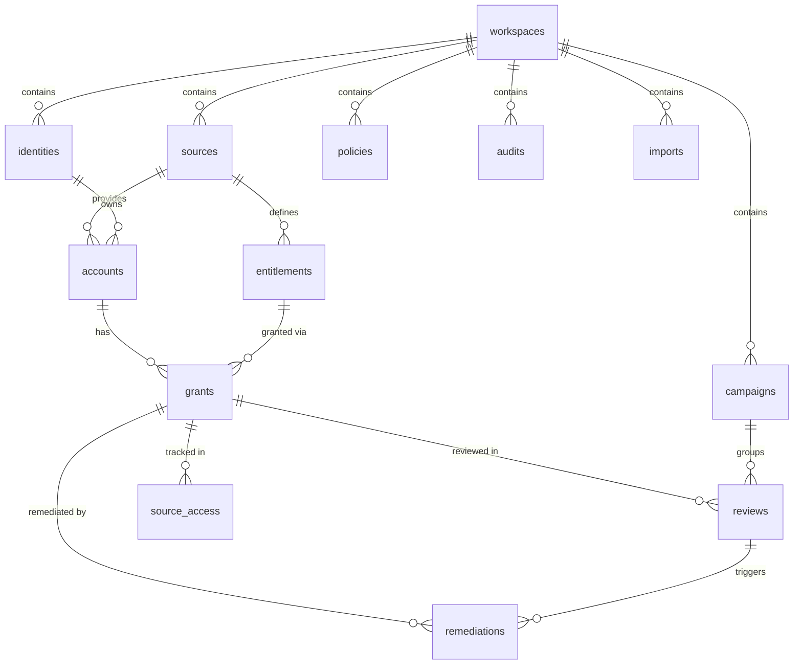

# Database Schema

## Overview

AccessGuard uses **Cloudflare D1 (SQLite)** with **Drizzle ORM**. The schema defines 12 tables with tenant isolation via `workspaceId` foreign keys. All migrations are tracked in `drizzle/` and applied via `pnpm db:migrate:local`.

## Entity Relationship

## Tables

### `workspaces`
Tenant isolation root. Every other table references a workspace.

| Column      | Type | Description          |
| ----------- | ---- | -------------------- |
| `id`        | TEXT | Primary key          |
| `createdAt` | TEXT | ISO 8601 timestamp   |
| `name`      | TEXT | Workspace display name |

### `identities`
Employee/people records imported from HR systems.

| Column        | Type | Description                                      |
| ------------- | ---- | ------------------------------------------------ |
| `id`          | TEXT | Primary key                                      |
| `workspaceId` | TEXT | FK → workspaces                                  |
| `employeeId`  | TEXT | Stable HR employee identifier                    |
| `name`        | TEXT | Full name                                        |
| `email`       | TEXT | Email address                                    |
| `department`  | TEXT | Department name                                  |
| `jobTitle`    | TEXT | Job title                                        |
| `managerId`   | TEXT | FK → identities (nullable, self-referencing)     |
| `status`      | TEXT | active, terminated, leave                        |
| `contractEnd` | TEXT | Contract end date (nullable, for contractors)    |

**Indexes:** `identities_workspace` on `(workspaceId)`

### `sources`
External systems providing access data (AWS, GitHub, Salesforce, etc.).

| Column        | Type | Description                    |
| ------------- | ---- | ------------------------------ |
| `id`          | TEXT | Primary key                    |
| `workspaceId` | TEXT | FK → workspaces                |
| `name`        | TEXT | Source system name             |
| `category`    | TEXT | Category (cloud, devops, etc.) |
| `icon`        | TEXT | UI icon identifier             |
| `lastSync`    | TEXT | Last synchronization timestamp |
| `status`      | TEXT | healthy, degraded, etc.        |
| `mode`        | TEXT | Connection mode                |

### `accounts`
Provider-specific user accounts linked to identities.

| Column        | Type | Description                       |
| ------------- | ---- | --------------------------------- |
| `id`          | TEXT | Primary key                       |
| `workspaceId` | TEXT | FK → workspaces                   |
| `sourceId`    | TEXT | FK → sources                      |
| `identityId`  | TEXT | FK → identities (nullable)        |
| `externalId`  | TEXT | External account ID               |
| `kind`        | TEXT | user, service, emergency          |
| `status`      | TEXT | enabled, disabled                 |
| `lastActive`  | TEXT | Last activity timestamp (nullable)|
| `createdAt`   | TEXT | Account creation timestamp        |

**Indexes:** `accounts_workspace` on `(workspaceId)`

### `entitlements`
Permissions/roles within a source system.

| Column              | Type    | Description                              |
| ------------------- | ------- | ---------------------------------------- |
| `id`                | TEXT    | Primary key                              |
| `workspaceId`       | TEXT    | FK → workspaces                          |
| `sourceId`          | TEXT    | FK → sources                             |
| `name`              | TEXT    | Permission name                          |
| `privileged`        | INTEGER | Boolean — is this a privileged role      |
| `allowedDepartments`| TEXT    | JSON array of allowed departments or `*` |

### `grants`
Links accounts to entitlements — who has what access.

| Column          | Type    | Description                           |
| --------------- | ------- | ------------------------------------- |
| `id`            | TEXT    | Primary key                           |
| `workspaceId`   | TEXT    | FK → workspaces                       |
| `accountId`     | TEXT    | FK → accounts                         |
| `entitlementId` | TEXT    | FK → entitlements                     |
| `state`         | TEXT    | active, revoked                       |
| `expiresAt`     | TEXT    | Expiry date for temporary permissions |
| `version`       | INTEGER | Optimistic concurrency version        |

**Indexes:** `grants_workspace_state` on `(workspaceId, state)`

### `source_access`
Independent mock source state used for remediation verification.

| Column        | Type    | Description                  |
| ------------- | ------- | ---------------------------- |
| `id`          | TEXT    | Primary key                  |
| `workspaceId` | TEXT    | FK → workspaces              |
| `grantId`     | TEXT    | FK → grants                  |
| `state`       | TEXT    | active, revoked              |
| `version`     | INTEGER | Version for conditional writes|
| `updatedAt`   | TEXT    | Last update timestamp        |

### `campaigns`
Review campaign grouping and scheduling.

| Column        | Type | Description            |
| ------------- | ---- | ---------------------- |
| `id`          | TEXT | Primary key            |
| `workspaceId` | TEXT | FK → workspaces        |
| `name`        | TEXT | Campaign name          |
| `startedAt`   | TEXT | Campaign start date    |
| `dueAt`       | TEXT | Campaign due date      |

### `reviews`
Access review findings with evidence, scores, and decisions.

| Column              | Type    | Description                                    |
| ------------------- | ------- | ---------------------------------------------- |
| `id`                | TEXT    | Primary key                                    |
| `workspaceId`       | TEXT    | FK → workspaces                                |
| `grantId`           | TEXT    | FK → grants                                    |
| `campaignId`        | TEXT    | FK → campaigns                                 |
| `assigneeId`        | TEXT    | Assigned reviewer identity                     |
| `score`             | INTEGER | Risk score (0–100)                             |
| `severity`          | TEXT    | critical, high, medium, low                    |
| `reasons`           | TEXT    | JSON array of human-readable reasons           |
| `codes`             | TEXT    | JSON array of policy codes                     |
| `recommendation`    | TEXT    | Suggested action                               |
| `status`            | TEXT    | pending, investigation, awaiting_second, keep, revoke, exception |
| `note`              | TEXT    | Reviewer's decision note                       |
| `firstActor`        | TEXT    | First approver (for critical dual approval)    |
| `proposal`          | TEXT    | Proposed decision (awaiting second approval)   |
| `decisionId`        | TEXT    | Unique decision token (prevents duplicates)    |
| `snapshotVersion`   | INTEGER | Grant version at time of scan                  |
| `sourceSnapshotAt`  | TEXT    | Source sync timestamp at scan                  |
| `evidence`          | TEXT    | Serialized evidence snapshot (JSON)            |
| `exceptionUntil`    | TEXT    | Exception expiry date (nullable)               |
| `dueAt`             | TEXT    | Review due date                                |
| `createdAt`         | TEXT    | Review creation timestamp                      |
| `decidedAt`         | TEXT    | Decision timestamp (nullable)                  |
| `version`           | INTEGER | Optimistic concurrency version                 |

**Indexes:**
- `reviews_workspace_status` on `(workspaceId, status)`
- `reviews_grant` on `(grantId)`
- `reviews_one_open_per_grant` — partial unique index ensuring at most one open review per grant

### `remediations`
Remediation job tracking for revoked access.

| Column            | Type    | Description                        |
| ----------------- | ------- | ---------------------------------- |
| `id`              | TEXT    | Primary key                        |
| `workspaceId`     | TEXT    | FK → workspaces                    |
| `reviewId`        | TEXT    | FK → reviews                       |
| `grantId`         | TEXT    | FK → grants                        |
| `status`          | TEXT    | queued, failed, verified           |
| `attempts`        | INTEGER | Execution attempt count            |
| `expectedVersion` | INTEGER | Expected source version for write  |
| `error`           | TEXT    | Error message (nullable)           |
| `evidence`        | TEXT    | Verification evidence (nullable)   |
| `leaseUntil`      | TEXT    | Worker lease expiry (nullable)     |
| `createdAt`       | TEXT    | Job creation timestamp             |
| `verifiedAt`      | TEXT    | Verification timestamp (nullable)  |

### `policies`
Configurable risk detection policies.

| Column        | Type    | Description                   |
| ------------- | ------- | ----------------------------- |
| `id`          | TEXT    | Primary key                   |
| `workspaceId` | TEXT    | FK → workspaces               |
| `code`        | TEXT    | Policy code (LEAVER, etc.)    |
| `name`        | TEXT    | Display name                  |
| `description` | TEXT    | Policy description            |
| `enabled`     | INTEGER | Boolean — is policy active    |
| `threshold`   | INTEGER | Configurable threshold value  |

### `audits`
Append-only audit trail.

| Column        | Type | Description                |
| ------------- | ---- | -------------------------- |
| `id`          | TEXT | Primary key                |
| `workspaceId` | TEXT | FK → workspaces            |
| `actor`       | TEXT | Human-readable actor name  |
| `principal`   | TEXT | Authenticated principal ID |
| `action`      | TEXT | Action performed           |
| `target`      | TEXT | Target of the action       |
| `detail`      | TEXT | Detailed action context    |
| `createdAt`   | TEXT | ISO 8601 timestamp         |

**Indexes:** `audits_workspace_date` on `(workspaceId, createdAt)`

### `imports`
Import deduplication and history.

| Column        | Type    | Description               |
| ------------- | ------- | ------------------------- |
| `id`          | TEXT    | Primary key               |
| `workspaceId` | TEXT    | FK → workspaces           |
| `checksum`    | TEXT    | SHA hash of imported file |
| `filename`    | TEXT    | Original filename         |
| `kind`        | TEXT    | hr, access                |
| `rowCount`    | INTEGER | Number of rows imported   |
| `createdAt`   | TEXT    | Import timestamp          |

## Migrations

| Migration                          | Description              |
| ---------------------------------- | ------------------------ |
| `0000_handy_zuras.sql`             | Initial schema creation  |
| `0001_productive_dreadnoughts.sql` | Schema evolution         |
| `0002_light_killmonger.sql`        | Schema evolution         |
| `0003_marvelous_magdalene.sql`     | Schema evolution         |

