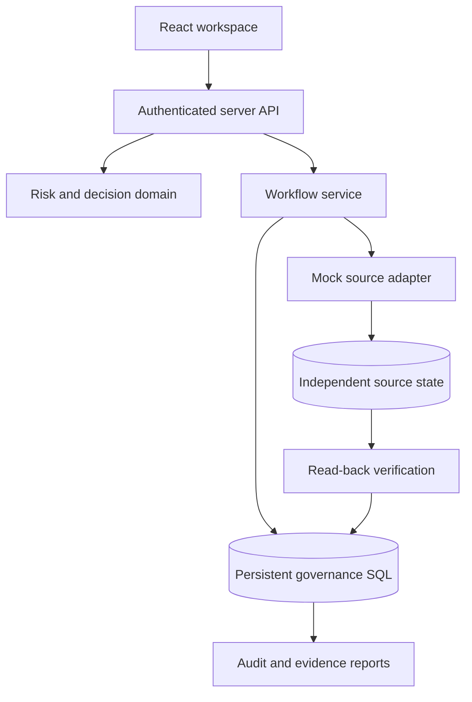

# Architecture and verification

## Boundaries

The UI calls a same-origin server API. The API establishes the platform identity and derives the workspace key from that identity, never from client-supplied workspace IDs. A demo persona selects a synthetic actor inside that owner's private sandbox. Use cases apply role checks and domain rules, then use tenant-scoped SQL and transactional batches. There is one deployable application with separate modules rather than multiple independently deployed microservices.

`identities` describe people. `accounts` describe provider-specific accounts. `entitlements` describe permissions. `grants` associate accounts and permissions. A permission can be removed without disabling the entire account.

## Decision transitions

Ordinary review: `pending / investigation -> keep | revoke | exception | investigation`.

Critical review: `pending / investigation -> awaiting_second -> independent confirmation -> proposed final decision`. A second reviewer can return it to investigation. The same synthetic employee cannot supply both approvals, and nobody may review their own access. Exceptions must expire within 1–90 days, including at confirmation time.

Final `revoke` creates a queued remediation in the same transactional batch as the review decision and its audit event. Optimistic version checks and a per-decision token prevent competing decisions from inserting duplicate jobs or audit records. A partial unique index permits at most one open review per grant, including concurrent scans.

## Evidence and remediation

Each review stores a serialized evidence snapshot containing the employee, account, entitlement, grant, source timestamp and relevant policy settings. The decision endpoint compares current evidence with that snapshot. Changed context requires a new scan; refreshed open reviews return to investigation, and pending second approvals are invalidated.

Execution revalidates approved context, claims a two-minute job lease and uses a version-conditional write to an independent mock source record. It then reads that record back. Only an observed revoked permission can update the governance grant and mark the job verified. Known failures are recorded, and retries are safe when the source is already revoked. An expired lease permits recovery after an interrupted worker. All connectors remain simulations.

## Import behavior

CSV files are fully parsed and validated before a transaction begins. Stable employee/provider keys preserve identity. Exact file checksums prevent accidental re-import. Conflicting owners or activity metadata for one account are rejected. Multi-row SQL statements stay within 100 bound parameters and preserve foreign-key insertion order. A failed batch rolls back the import.

Imports are additive/upsert-only. Omitted rows are retained. Unknown non-empty employee IDs are rejected; an empty ID intentionally creates an unverified-owner account. Service and emergency accounts do not use human inactivity rules. Imported application permissions initially have a wildcard department baseline, so the built-in department-mismatch policy is principally demonstrated with seeded applications.

## Requirement traceability

| Industry requirement | Implemented behavior | Verification |
| --- | --- | --- |
| Consolidate entitlement data | Multiple seeded sources and atomic CSV imports | Tenant-scoped initialization; HR/access import; 1,000-row import tests |
| Detect inactive/orphaned/excessive access | Six explainable rules; safe handling of leave, service accounts and unknown activity | Pure-domain positive and negative rule tests |
| Risk-based recommendations | Priority scores, reason codes, source evidence and configurable policies | Domain tests; captured-evidence inspection |
| Reviewer assignment and approvals | Manager assignment, fallback security queue, critical independent approval | Assignment/authorization checks, self-approval and second-approval tests |
| Remediation tracking | Durable queued/failed/verified jobs and independent read-back | Full workflow, safe failure, version conflict and lease-recovery tests |
| Audit reports and dashboards | Database-derived metrics, review CSV and full audit CSV | CSV export tests, formula-injection test and browser walkthrough |

## Verification completed

- 35 automated tests pass against domain logic, actual use-case code, route handlers and disposable SQLite databases with foreign keys and D1-style bind limits.
- TypeScript check passes across application and test code.
- Production build is validated through the Sites build workflow.
- Browser checks cover critical first/second approval and a verified remediation. Additional final browser QA covers import, export and narrow-screen layout.

The in-memory D1 adapter reproduces SQL execution and batch rollback, not every Cloudflare concurrency characteristic or production resource limit. Browser QA exercises a local D1-backed preview separately. CI configuration is supplied; hosted GitHub Actions execution is not claimed.

## Scaling next

Move workspace reads to server-side filtering/pagination; partition scans into bounded jobs; decouple a real source adapter from review persistence; use an outbox dispatcher and monitored queue; add retry backoff and dead-letter handling; stream reports and external audit events; benchmark with representative enterprise identities, grants and skewed distributions. No enterprise throughput result is claimed from synthetic data.
